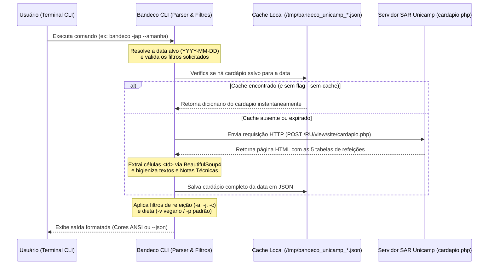

# BANDECO — Cardápio do RU da Unicamp Limeira via CLI

**BANDECO** é uma ferramenta de linha de comando (CLI) rápida e leve para consultar o cardápio diário do **Restaurante Universitário (RU) da Unicamp de Limeira (FCA / FT)** diretamente pelo terminal.

A aplicação realiza a consulta automatizada ao portal do **SAR (Serviço de Apoio ao Estudante)**, faz o *parsing* e higienização das tabelas HTML de cada refeição e armazena o resultado em **cache local temporário** por data — garantindo respostas instantâneas nas consultas seguintes e permitindo filtragem avançada por período, dieta (padrão ou vegana) e exportação em **JSON**.

---

## Principais Funcionalidades

- **Filtros por Refeição e Dieta**:
  - **Refeições**: consulte apenas **Café da Manhã** (`-c`), **Almoço** (`-a`), **Jantar** (`-j`) ou combine múltiplas flags (ex: `-aj`).
  - **Dieta**: filtre exclusivamente pelo cardápio **Vegano** (`-v` / `--vegano`) ou **Padrão** (`-p` / `--padrao`).
- **Navegação Rápida por Datas**:
  - Consulte o cardápio do dia atual por padrão, utilize os atalhos **Amanhã** (`-m` / `--amanha`) e **Ontem** (`-o` / `--ontem`), ou informe qualquer data específica (`--data dd-mm-yyyy`).
- **Cache Local Inteligente**:
  - Armazena automaticamente o cardápio extraído em arquivo temporário (`bandeco_unicamp_YYYY-MM-DD.json`), evitando requisições HTTP repetidas ao servidor da Unicamp na mesma data (com opção `--sem-cache` para forçar atualização).
- **Saída Colorida (ANSI) & Exportação JSON**:
  - Destaque visual de títulos, itens e alertas na **Nota Técnica** (glúten, lactose, alérgenos) com detecção automática de terminal (`TTY` / `NO_COLOR`) ou desativação manual (`--sem-cor`).
  - Modo `--json` para integração direta com scripts, bots ou barras de status (Polybar, Waybar, i3status).

---

## Stack Tecnológica

| Camada | Tecnologias |
| :--- | :--- |
| **Linguagem & Runtime** | Python 3.8+ (`argparse`, `datetime`, `json`, `tempfile`, `pathlib`) |
| **Requisições HTTP** | `requests` (POST com `timeout` e validação de status HTTP) |
| **Web Scraping / Parsing** | `BeautifulSoup4` (`bs4` + `html.parser`) |
| **Empacotamento & Distribuição** | `setuptools` (`pyproject.toml` / `setup.py`), `stdeb` (`.deb` Debian Package) |
| **Qualidade & Testes** | `unittest` (Testes automatizados de *parsing*, filtros, datas e cache) |

---

## Como Funciona o Bandeco



---

## Instalação

### Opção 1: Pacote Debian (`.deb` — Ubuntu / Debian / Mint)

1. Na seção **Releases** (barra lateral direita do repositório), baixe o arquivo `.deb` da versão mais recente.
2. Instale o pacote via `apt` ou `dpkg`:
   ```bash
   sudo apt install ./python3-bandeco_1.1.0-1_all.deb
   # ou: sudo dpkg -i python3-bandeco_1.1.0-1_all.deb
   ```
3. Execute no terminal:
   ```bash
   bandeco
   ```

### Opção 2: Via `pip` ou `pipx` (Qualquer Sistema Operacional)

1. Clone o repositório e entre na pasta do projeto:
   ```bash
   git clone https://github.com/zedutra/bandeco-unicamp-limeira.git
   cd bandeco-unicamp-limeira
   ```
2. Instale o pacote globalmente ou no seu ambiente virtual:
   ```bash
   pip install .
   # ou usando pipx:
   pipx install .
   ```

### Opção 3: Executando Diretamente (Sem Instalar Pacote)

```bash
git clone https://github.com/zedutra/bandeco-unicamp-limeira.git
cd bandeco-unicamp-limeira
pip install -r requirements.txt
python3 bandeco/bandeco.py
```

---

## Uso e Exemplos

### Consultar almoço e jantar padrão de uma data específica
```bash
bandeco -jap --data=18-05-2024
```
```text
Almoço Padrão:
  Acompanhamentos: ARROZ E FEIJÃO
  Prato Principal: Frango a espanhola
  Guarnição: Batata palha
  Salada: Couve
  Sobremesa: Banana
  Refresco: Uva
  Extra: PÃO E CAFÉ
  Nota Técnica: Contém glúten no pão. Não contém ovos e lactose. Contém glúten na batata palha.

Jantar Padrão:
  Acompanhamentos: ARROZ E FEIJÃO
  Prato Principal: Moqueca de peixe
  Guarnição: Abobrinha aromatizada com alecrim
  Salada: Jiló
  Sobremesa: Maçã
  Refresco: Uva
  Extra: PÃO E CAFÉ
  Nota Técnica: Contém glúten no pão. Não contém ovos e lactose.
```

### Consultar apenas o cardápio vegano de amanhã
```bash
bandeco -v --amanha
```

### Exportar o almoço do dia em formato JSON
```bash
bandeco -a --json
```

### Tabela de Opções (`bandeco -h`)

```text
usage: bandeco [-h] [-v] [-p] [-a] [-j] [-c] [--data DATA | -m | -o] [--json] [--sem-cor] [--sem-cache]

Programa para verificar o cardápio do restaurante universitário da Unicamp de Limeira

options:
  -h, --help            Exibe esta mensagem de ajuda e encerra
  -v, -vegano, --vegano Filtra pelas refeições veganas
  -p, -padrao, --padrao Filtra pelas refeições padrão
  -a, -almoco, --almoco Requisita o cardápio do almoço
  -j, -jantar, --jantar Requisita o cardápio do jantar
  -c, -cafe, --cafe     Requisita o cardápio do café da manhã
  --data DATA           Data no formato dd-mm-yyyy
  -m, --amanha          Requisita o cardápio de amanhã
  -o, --ontem           Requisita o cardápio de ontem
  --json                Exibe o cardápio em formato JSON
  --sem-cor             Desativa a formatação colorida no terminal
  --sem-cache           Ignora o cache local e força nova requisição
```

---

## Comandos de Qualidade e Testes

```bash
# Executar a suíte de testes unitários
python3 -m unittest discover -s tests -v

# Gerar pacote Debian (.deb) em sistemas Ubuntu/Debian
python3 setup.py --command-packages=stdeb.command bdist_deb
```
